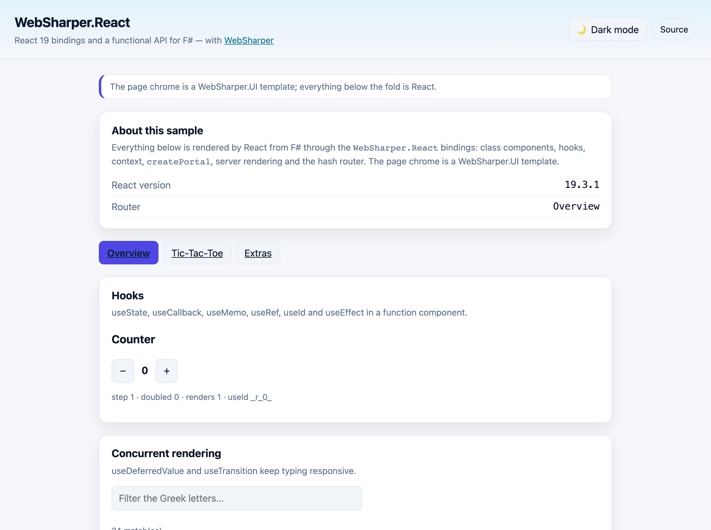

# WebSharper.React

[](https://www.nuget.org/packages/WebSharper.React)

**WebSharper.React** is an abstraction over the JavaScript library [React](https://react.dev/) for
[WebSharper](https://websharper.com). It provides a type-safe, functional API over React and removes the need
for JSX: elements are ordinary F# values built with combinators, and components are ordinary F# functions and
classes.

The binding targets **React 19** (`react` and `react-dom` `>= 19.3.1 < 20.0.0`), imported from npm and bundled
by WebSharper together with your application.

This repository contains:

| Project | Purpose |
| --- | --- |
| `WebSharper.React.Bindings` | The binding: WIG definitions for `React`, `ReactDOM`, `ReactDOMClient`, `ReactDOMServer`, the hooks, the synthetic events and their option dictionaries. |
| `WebSharper.React` | The abstraction: the `Html` DSL (`div`, `button`, `on.click`, …), `ReactHelpers` (element and component helpers, the hash router), the props/tags DSL and the `WebSharper.Sitelets` integration. |
| `WebSharper.React.Tests` | The sample/test case: a WebSharper.UI template whose chrome hosts a React tree that exercises the hooks, context, portals, class components, server rendering and the hash router. |

## Live demos

**Try it live:** [Open the sample in your browser](https://dotnet-websharper.github.io/react/)



The sample doubles as the binding's [test case](#running-the-test-case): it renders a function component with
`useState`/`useCallback`/`useMemo`/`useRef`/`useId`/`useEffect`, filters a list with `useDeferredValue` and
`useTransition`, drives a `useReducer` counter, shares a `createContext` value with `Provider`/`Consumer`/
`useContext`, opens a dialog with `createPortal`, server-renders strings with `renderToString`/
`renderToStaticMarkup` and plays the classic Tic-Tac-Toe with class components.

- **Sample (this repository):** <https://dotnet-websharper.github.io/react/>
- **Source repository:** <https://github.com/dotnet-websharper/react>
- **WebSharper bindings:** <https://websharper.com/bindings>
- **Tic-Tac-Toe on Try WebSharper:** <http://try.websharper.com/snippet/loic.denuziere/0000Lt>

## Installation

```bash
dotnet add package WebSharper.React
```

or, from the NuGet console:

```powershell
nuget WebSharper.React
```

Alternatively, reference the projects from source:

```xml
<ItemGroup>
  <ProjectReference Include="path/to/WebSharper.React.Bindings/WebSharper.React.Bindings.fsproj" />
  <ProjectReference Include="path/to/WebSharper.React/WebSharper.React.fsproj" />
</ItemGroup>
```

## Usage

### Elements

`WebSharper.React.Html` provides one function per HTML tag. Each takes a list of properties and a list of
children, and attributes/events come from the `attr` and `on` modules:

```fsharp
open WebSharper
open WebSharper.React
open WebSharper.React.Html

[<JavaScript>]
let View () =
    div [ attr.className "card" ] [
        h2 [] [ text "Hello from React" ]
        button [
            attr.className "btn"
            on.click (fun _ -> Console.Log "clicked")
        ] [ text "Click me" ]
    ]
```

### Function components and hooks

A function component is an F# function from props to `React.Element`, instantiated with
`ReactHelpers.OfFunction`. Hooks are the `React.Use*` members:

```fsharp
type CounterProps = { step: int }

let Counter (props: CounterProps) =
    let count, setCount = React.UseState 0
    let doubled = React.UseMemo((fun () -> count * 2), [| box count |])
    div [] [
        button [ on.click (fun _ -> setCount.Invoke (count - props.step)) ] [ text "−" ]
        strong [] [ text (string count) ]
        button [ on.click (fun _ -> setCount.Invoke (count + props.step)) ] [ text "+" ]
        span [] [ textf "doubled: %d" doubled ]
    ]

let view () = ReactHelpers.OfFunction Counter { step = 1 }
```

> The `Use*` members return JavaScript functions (for example the `useState` setter), which surface in .NET as
> `System.Action<_>` values — invoke them with `.Invoke`.

### Class components

```fsharp
type BoardProps = { squares: string[] }

type Board(props) =
    inherit React.Component<BoardProps, unit>(props)

    override this.Render() =
        div [] [
            for i in 0 .. this.Props.squares.Length - 1 do
                button [ attr.key i ] [ text this.Props.squares.[i] ]
        ]
```

### Mounting and routing

`ReactHelpers.Mount` attaches a React tree to a DOM node using `ReactDOMClient.createRoot`;
`ReactHelpers.HashRouter` gives you a `Sitelets`-based client-side router:

```fsharp
[<SPAEntryPoint>]
let Main () =
    ReactHelpers.HashRouter (Router.Infer<EndPoint>()) (fun router ->
        match router.State with
        | Home -> HomePage router
        | Game -> GamePage router)
    |> ReactHelpers.Mount (JS.Document.GetElementById "main")
```

## Notes on the API

- **React 19.** The React 19 API is fully reflected: `use`, `useActionState`, `useOptimistic`, `useEffectEvent`
  and `useDeferredValue` (with an initial value), the `<Activity>`, `<StrictMode>`, `<Profiler>`, `<Fragment>`
  and `<Suspense>` element types, `React.lazy`, `React.act` and `React.cloneElement`, `ReactDOM.useFormStatus`
  and the resource-preloading APIs (`preload`, `preinit`, `prefetchDNS`, …).
- **Removed in React 19.** `ReactDOM.render`, `ReactDOM.hydrate`, `ReactDOM.unmountComponentAtNode`,
  `ReactDOM.findDOMNode`, `renderToNodeStream` and `renderToStaticNodeStream` are gone. Use
  `ReactDOMClient.createRoot` / `ReactDOMClient.hydrateRoot` and `root.unmount()` instead — `ReactHelpers.Mount`
  and `ReactHelpers.mountById` already do.
- **Function components** are created with `ReactHelpers.OfFunction`; class components with `ReactHelpers.Make`.
  `ReactHelpers.nothing` is a `React.Element` that renders nothing.
- **Props DSL.** `ReactNew.fs` defines the `attr.*`, `on.*` and `CSSProp` vocabularies used by the `Html`
  module; property names are lower-cased on the first letter when they are turned into a React props object.
- **SSR.** `ReactDOMServer.renderToString` and `renderToStaticMarkup` can be called from the browser bundle;
  `renderToReadableStream` is typed against `WebSharper.JavaScript.ReadableStream`.
- **Routing.** `ReactHelpers.HashRouter` is built on `WebSharper.Sitelets` `Router.Infer` and does not require
  the ASP.NET Core host.

## Running the test case

Build the sample in Release and serve its static output. The build bundles `react`/`react-dom` with esbuild into
`dist/`:

```bash
dotnet build WebSharper.React.Tests/WebSharper.React.Tests.fsproj -c Release

dotnet tool install -g dotnet-serve   # once
dotnet serve -d dist -p 8080
```

Open <http://localhost:8080/>. The page chrome is a WebSharper.UI template (with a light/dark theme switcher);
everything in the React area is rendered by the binding's sample.

## Building from source

### Prerequisites

- [.NET SDK 10](https://dotnet.microsoft.com/download) or later (the WebSharper 11 compiler needs the .NET 11
  runtime, which ships with the SDK).
- [Node.js](https://nodejs.org/) — the sample's esbuild step installs and bundles the npm `react`/`react-dom`
  packages.
- [Paket](https://fsprojects.github.io/Paket/) is restored as a local tool (`dotnet tool restore`).

### Build

```bash
dotnet tool restore
dotnet paket restore
dotnet build WebSharper.React.sln -c Release
```

The binding projects target `netstandard2.0`; the sample targets `net10.0`.

`./build <target>` wraps the same steps and drives the shared WebSharper build script (`CI-Release`,
`WS-Package`). With no target it runs the default `Build`.

## Pack

```bash
WSPackageFolder=/tmp/pkg dotnet fsi ./build.fsx -t WS-Package
```

This produces `WebSharper.React.<version>.nupkg` from `nuget/WebSharper.React.paket.template`, packing both
assemblies together with their `.xml` documentation and their WebSharper `.websharper` sidecars.

## Deployment

Pushing to the default branch triggers `.github/workflows/ghpages.yml`, which builds the sample in Release and
publishes `dist/` to the `gh-pages` branch.

## Repository layout

```
WebSharper.React.Bindings/    # WIG definitions (Main.fs)
WebSharper.React/             # Html DSL, ReactHelpers, props/tags DSL, router
WebSharper.React.Tests/       # sample/test case (Client.fs, TicTacToe.fs, index.html, site.css)
docs/sample.png               # screenshot of the running sample
nuget/                        # Paket pack template
build.fsx, build.sh, build.cmd, paket.dependencies
.github/workflows/ghpages.yml # build + deploy the sample to GitHub Pages
```

## License

Apache 2.0 — see [LICENSE.md](LICENSE.md).
